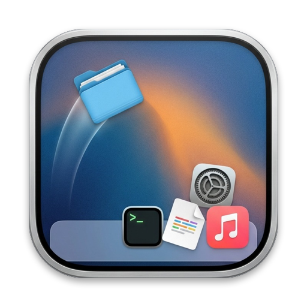
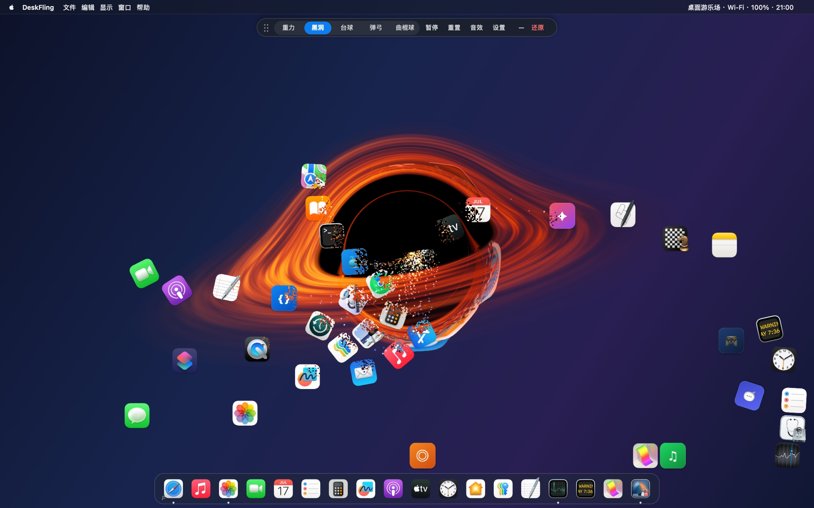
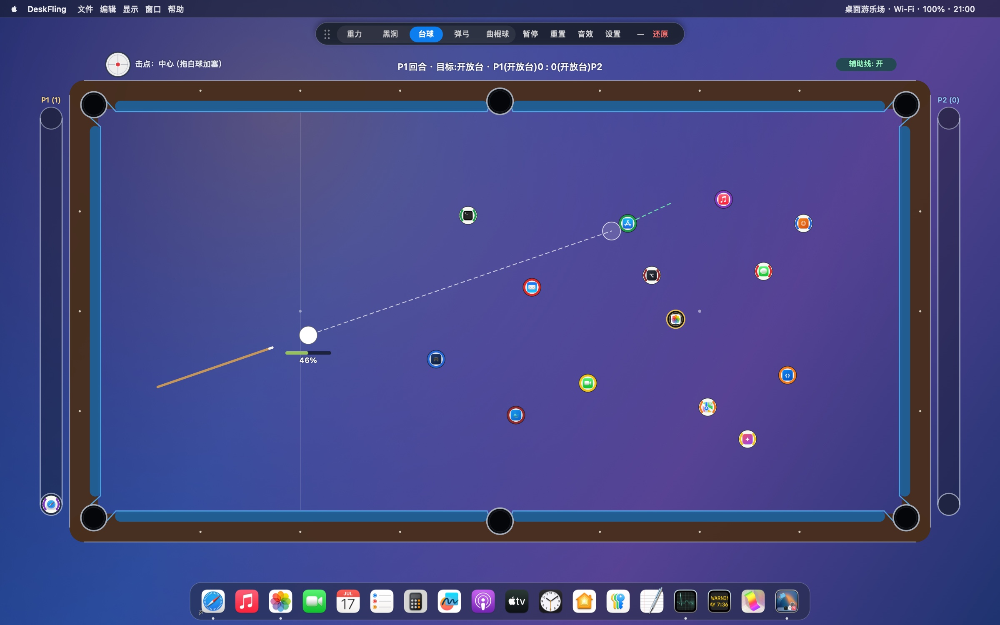
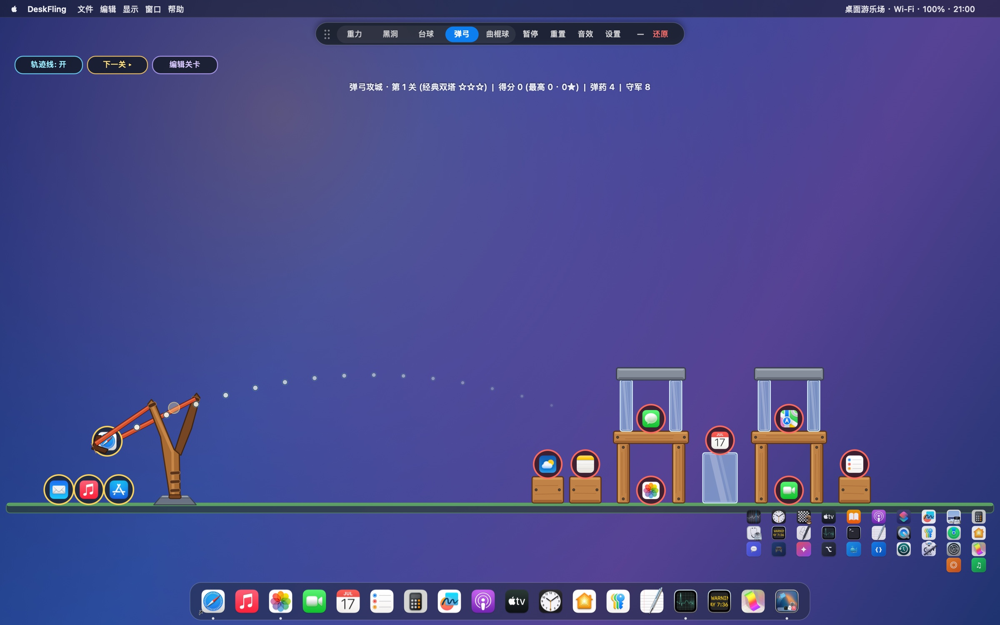
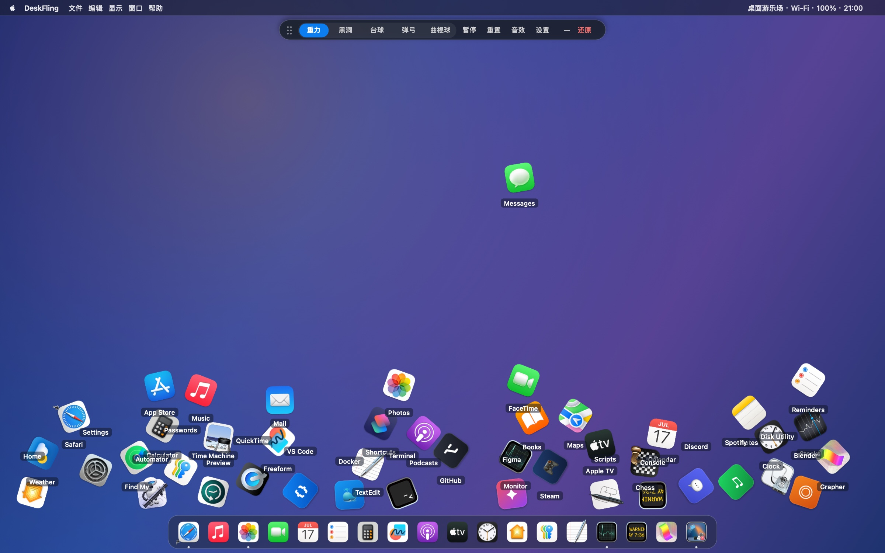
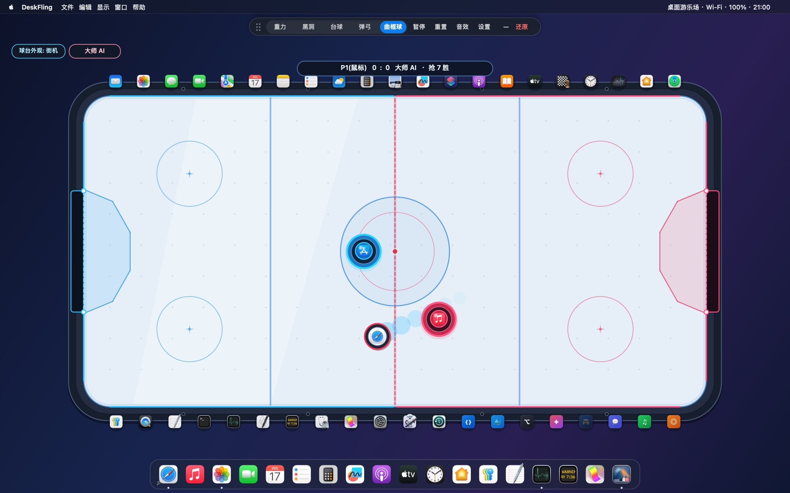

<div align="center">
  
  <h1>桌面游乐场 · DeskFling</h1>
  <p><strong>把你的桌面图标变成实时 2D 物理与 3D 光追竞技游乐场 · 按 Esc 随时秒级无损还原</strong></p>
  <p>
    <a href="README_EN.md">English</a> · <strong>简体中文</strong>
  </p>
  <p>
    
    
    
    
    <a href="LICENSE"></a>
  </p>
</div>

---

<p align="center">
  
</p>

<table>
  <tr>
    <td width="50%">
      
      <p align="center"><sub><strong>🎱 桌面图标台球</strong> · 国际八球 / 斯诺克 · 3D 加塞 · AI 与局域网对战</sub></p>
    </td>
    <td width="50%">
      
      <p align="center"><sub><strong>🏹 弹弓攻城 & 关卡工坊</strong> · 多材质物理堡垒 · 自定义搭建阵型</sub></p>
    </td>
  </tr>
  <tr>
    <td width="50%">
      
      <p align="center"><sub><strong>🪐 科学重力游乐场</strong> · 星球引力预设 · 自由抓甩碰撞 · 可选位置写回</sub></p>
    </td>
    <td width="50%">
      
      <p align="center"><sub><strong>🏒 120Hz 空气曲棍球</strong> · 1:1 零延迟跟手 · 三档 AI 与双人/局域网联机</sub></p>
    </td>
  </tr>
</table>

## ✨ 核心特性

- **五大原生桌面玩法一键无缝切换**
  - **🪐 重力游乐场 (Gravity)**：内置太空失重、月球、火星、地球、木星等真实 SI 物理天体引力预设与四向重力切换；支持抓起任意软件图标甩向满屏图标堆，也可主动将新排布写回真实桌面（支持一键撤销）。
  - **🕳 3D 光追黑洞 (3D Schwarzschild Black Hole)**：基于 Apple Metal 与 Direct3D 11 HLSL 的实时史瓦西零测地线光线追踪，呈现引力透镜光子环、动态螺旋等离子体吸积盘与图标潮汐撕裂粒子流；按住 `Option`（Mac）/ `Alt`（Win）拖动即可自由旋转三维倾角。
  - **🎱 桌面图标台球 (Desktop Billiards)**：还原国际中式八球 / 美式 8-Ball（`2540×1270 mm`）与 WPBSA 12 英尺斯诺克球台比例，支持白球 3D 高低杆与左右塞旋转、幽灵球折射瞄准辅助线、三种球台主题（完整 / 极简线框 / 无框纯图标）、四档 AI（含宗师 Goat）以及 Windows ↔ macOS 跨平台局域网对战。
  - **🏹 弹弓攻城 (Slingshot Siege)**：拉动桌面左侧弹弓，发射图标轰击木材、玻璃与巨石堆砌的多层守军堡垒；内置可视化**关卡工坊**，随手拖拽即可设计专属关卡。
  - **🏒 120Hz 空气曲棍球 (Air Hockey)**：针对高刷屏优化的 120Hz 物理步进与 1:1 鼠标跟手操控，支持三档主动发球攻防 AI、同屏双人及局域网 UDP 房间自动发现联机。
- **🖥 单屏专注 & 多屏跨屏打通**
  - 支持在启动器或游戏内「设置 → 显示屏幕」实时切换：**仅指定单块屏幕游玩**（副屏保留静态鼠标穿透图标，边办公/看视频边玩互不干扰），或开启 **🌐 多屏跨屏显示**（左屏拉满弹弓跨过屏幕边框轰击右屏城堡、多屏连通黑洞与宽幅球台）。
- **🛡 零文件改动 & 独立进程秒级还原**
  - 默认仅对桌面图标生成高清内存镜像，**绝不移动、重命名或修改你的任何真实桌面文件**；游玩中依然可右键直接打开对应原文件/软件。
  - 内置独立守护子进程（Out-of-Process Watchdog）：按 **`Esc`**、点击胶囊条**「还原」**即刻恢复原桌面；即便遭遇进程强退或意外崩溃，守护进程也会自动将系统桌面图标恢复原状（同时附带双击即用的 `紧急恢复桌面` 脚本）。
- **⚡️ 纯原生 C++20 轻量高性能**
  - 零 Electron / 零浏览器内核，纯 C++20 + Box2D v3.1.1 + 原生 AppKit / CoreAnimation / Metal（macOS）与 Win32 / Direct2D / Direct3D 11（Windows），安装包仅 ~1–3 MB，程序化实时合成 8 路物理碰撞音效。

---

## 📦 下载与安装

请前往右侧 [**Releases**](https://github.com/qzue/DeskFling/releases/latest) 页面下载对应系统最新版本：

### 🍎 macOS（支持 macOS 13 Ventura / Sonoma / Sequoia，Apple Silicon & Intel）
1. 下载 **`DeskFling-macOS.dmg`**，双击打开并将 **`DeskFling.app`** 拖入 `Applications`（应用程序）目录。
2. **首次打开未公证开源应用说明**：若 macOS 弹出「无法验证开发者」或「已损坏，无法打开」，打开终端执行以下一行命令清除下载隔离属性即可正常双击启动：
   ```bash
   sudo xattr -rd com.apple.quarantine /Applications/DeskFling.app
   ```
3. 点击 **「▶ 开始游玩」**，首次运行在系统弹出的「访达 (Finder)」权限框点击**允许**即可进入游乐场；按 **`Esc`** 随时秒级还原。

### 🪟 Windows（支持 Windows 10 2004+ / Windows 11，x64）
1. 下载 **`DeskFling-Windows-x64.zip`**，**先完整解压到任意普通文件夹**。
2. 双击运行 **`DeskFling.exe`**（无需管理员权限）。
   > 若首次运行弹出 Windows Defender SmartScreen 蓝色提示框，点击 **「更多信息」→「仍要运行」** 即可。
3. 按 **`Esc`**、点击顶部胶囊条**「还原」**或右下角系统托盘菜单即可秒级恢复桌面图标。

---

## 🔨 从源码构建

### 环境要求
- **CMake** `>= 3.25`、支持 **C++20** 的编译器
- **macOS**：Xcode 15+ / Apple Clang（含 Ninja）
- **Windows**：Visual Studio 2022（勾选「使用 C++ 的桌面开发」与 Windows 10/11 SDK）

### macOS 编译与打包
```bash
cmake --preset macos
cmake --build --preset macos-release
ctest --preset macos-release --output-on-failure

# 生成 dist/macos-release/DeskFling.app 与 dist/DeskFling-macOS.dmg
./scripts/package-macos.sh
```

### Windows (PowerShell) 编译与打包
```powershell
cmake --preset windows-msvc
cmake --build --preset windows-release
ctest --preset windows-release --output-on-failure

# 生成 dist/DeskFling-Windows-x64.zip
./scripts/package-windows.ps1
```

更多技术架构与平台集成细节请参阅 [架构说明](docs/architecture.md)、[桌面集成与安全边界](docs/desktop-integration.md) 与 [Windows 构建指南](docs/windows-build.md)。

---

## 📄 开源协议与致谢

- 本项目基于 [**MIT License**](LICENSE) 开源。
- 物理引擎采用 Erin Catto 开发的 [**Box2D v3.1.1**](https://github.com/erincatto/box2d)（MIT），单元测试基于 [**GoogleTest**](https://github.com/google/googletest)（BSD-3-Clause），详见 [THIRD_PARTY_NOTICES.md](THIRD_PARTY_NOTICES.md)。
