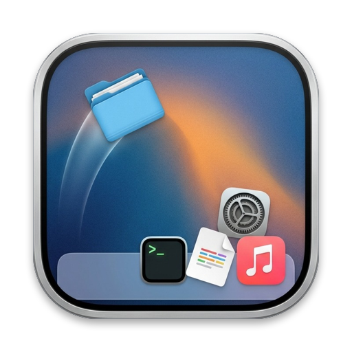
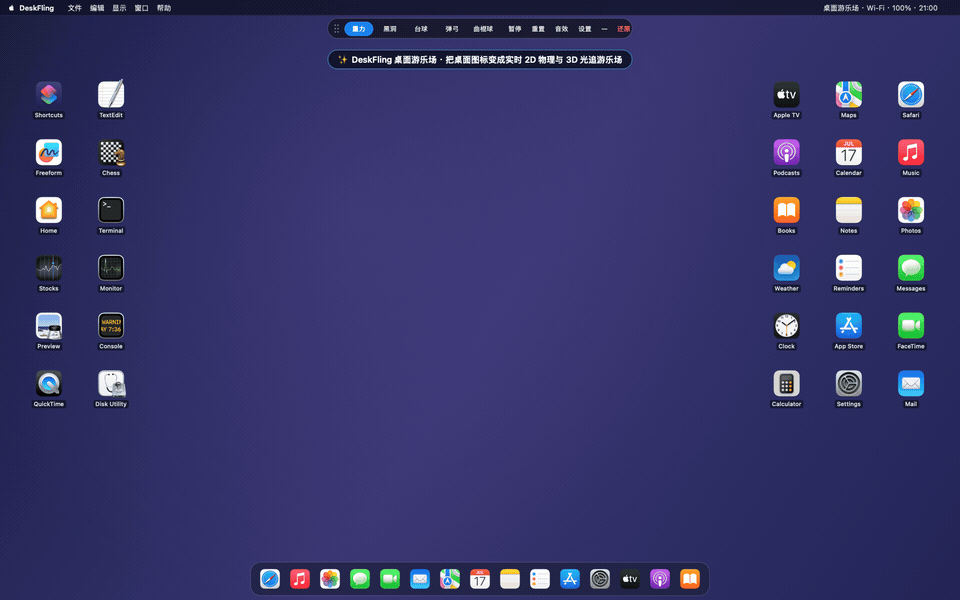
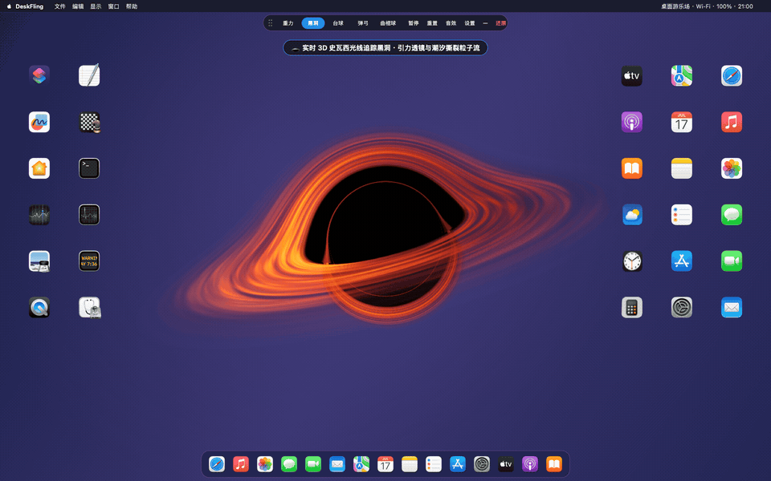
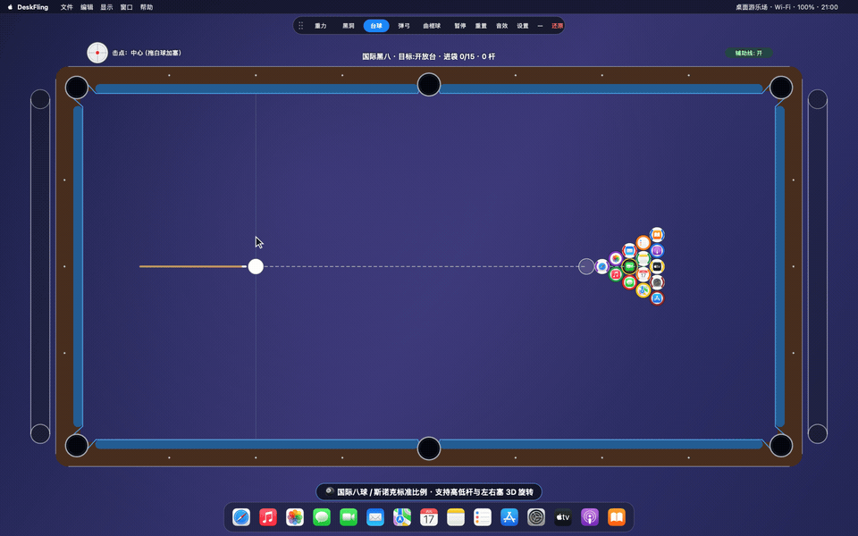
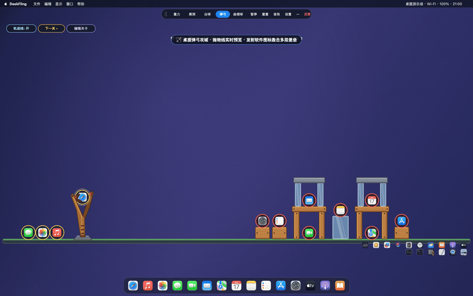
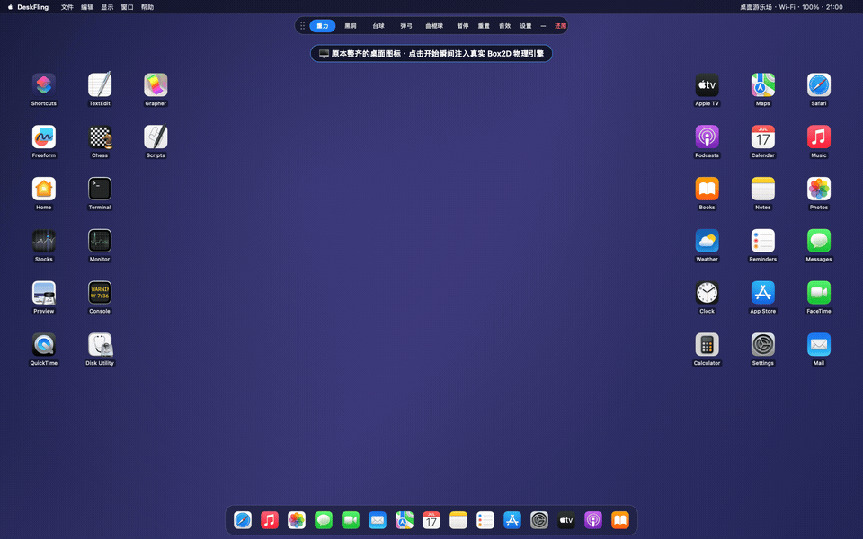
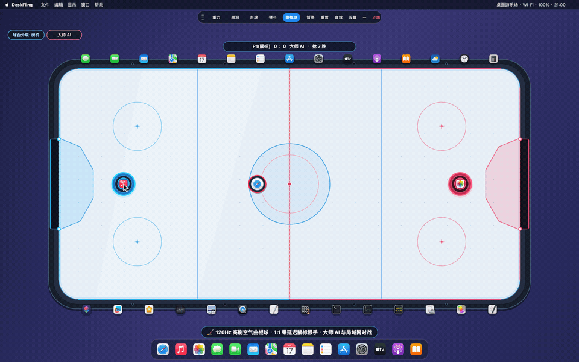

<div align="center">
  
  <h1>DeskFling · 桌面游乐场</h1>
  <p><strong>Turn your desktop icons into a real-time 2D physics & 3D ray-traced playground — press Esc anytime for instant, lossless restoration.</strong></p>
  <p>
    <strong>English</strong> · <a href="README.md">简体中文</a>
  </p>
  <p>
    
    
    
    
    <a href="LICENSE"></a>
    <a href="https://linux.do/"></a>
  </p>
</div>

---

<p align="center">
  
  <br />
  <sub><strong>🎬 8-Second Live Overview</strong> · Gravity Drop → 3D Ray-Traced Black Hole → Icon Billiards → Slingshot Siege → Instant <code>Esc</code> Restore</sub>
</p>

<table>
  <tr>
    <td colspan="2">
      
      <p align="center"><sub><strong>🕳 3D Schwarzschild GPU Black Hole</strong> · Real-Time Metal & D3D11 Geodesic Lensing · Tidal Particle Streams · Free <code>Option</code>/<code>Alt</code> 3D Orbit</sub></p>
    </td>
  </tr>
  <tr>
    <td width="50%">
      
      <p align="center"><sub><strong>🎱 Desktop Icon Billiards</strong> · 8-Ball & 12-ft Snooker · 3D English Spin · AI & Cross-Platform LAN</sub></p>
    </td>
    <td width="50%">
      
      <p align="center"><sub><strong>🏹 Slingshot Siege & Level Workshop</strong> · Multi-material Physics Fortresses · Custom Level Builder</sub></p>
    </td>
  </tr>
  <tr>
    <td width="50%">
      
      <p align="center"><sub><strong>🪐 Scientific Gravity Playground</strong> · Celestial Presets · Grab & Fling · Instant <code>Esc</code> Restore</sub></p>
    </td>
    <td width="50%">
      
      <p align="center"><sub><strong>🏒 120Hz Neon Air Hockey</strong> · 1:1 Zero-Lag Cursor Tracking · 3 AI Tiers & UDP LAN Matchmaking</sub></p>
    </td>
  </tr>
</table>

## ✨ Highlights

- **Five Native PlayModes in One Floating Capsule Bar**
  - **🪐 Gravity Playground**: Zero-G, Moon, Mars, Earth, and Jupiter SI presets with 4-way gravity directions, bouncy icon flinging, and opt-in layout writeback with one-click Undo.
  - **🕳 3D Schwarzschild GPU Black Hole**: Real-time null-geodesic ray-tracing in Metal (macOS) and Direct3D 11 HLSL (Windows) with lensed Einstein photon rings, orbiting spiral plasma arms, tidal spaghettification particles, and `Option`/`Alt`-drag free 3D camera orbit.
  - **🎱 Desktop Icon Billiards**: International 8-Ball / Heyball and WPBSA 12-ft Snooker proportions, 3D cue ball spin (follow/stun/draw/side english), ghost-ball ray-cast aim guides, Full / Minimal / Borderless themes, 4 AI tiers, and Windows ↔ macOS LAN play.
  - **🏹 Slingshot Siege**: Launch desktop icons into wood, glass, and stone fortresses, or build custom stages directly on your wallpaper with the built-in Level Workshop.
  - **🏒 120Hz Air Hockey**: Crisp 120Hz physics stepping, 1:1 mallet responsiveness, active face-off AI across 3 difficulties, 2P hotseat, and automatic UDP LAN room discovery.
- **🖥 Single-Display Focus or Panoramic Multi-Monitor Span**
  - Switch live in-session between playing on a single chosen monitor (leaving other screens click-through for work) or spanning all connected displays into one continuous physics arena.
- **🛡 Non-Destructive & Crash-Safe Watchdog Architecture**
  - DeskFling operates on in-memory high-DPI icon replicas and **never moves, renames, or alters your actual files** unless you explicitly click *Save Layout to Desktop*.
  - An independent out-of-process watchdog helper monitors heartbeats and restores native desktop icon visibility automatically on **`Esc`**, normal exit, or unexpected crashes.
- **⚡️ Tiny Native C++20 Footprint**
  - Zero Electron / WebView bloat (~1–3 MB native binary) powered by C++20, Box2D v3.1.1, AppKit/Metal/CoreAnimation on macOS, Win32/Direct2D/D3D11 on Windows, and procedural 8-voice collision audio.

---

## 📦 Installation

Download the latest build from [**Releases**](https://github.com/qzue/DeskFling/releases/latest):

### 🍎 macOS (macOS 13+ Ventura / Sonoma / Sequoia)
1. Open **`DeskFling-macOS.dmg`** and drag **`DeskFling.app`** into `/Applications`.
2. **First Launch (Unsigned Open-Source App)**: If Gatekeeper reports that the developer cannot be verified or the app is damaged, clear the quarantine attribute once in Terminal:
   ```bash
   sudo xattr -rd com.apple.quarantine /Applications/DeskFling.app
   ```
3. Launch **DeskFling**, click **▶ Start Playing**, grant Finder Automation when prompted, and press **`Esc`** anytime to restore your desktop.

### 🪟 Windows (Windows 10 2004+ / Windows 11, x64)
1. Extract **`DeskFling-Windows-x64.zip`** completely to a regular folder.
2. Double-click **`DeskFling.exe`** (no Administrator privileges required; if Windows SmartScreen appears, click **More info → Run anyway**).
3. Press **`Esc`** or click **Restore** on the top capsule bar anytime to restore native desktop icons.

---

## 🔨 Build from Source

### macOS
```bash
cmake --preset macos
cmake --build --preset macos-release
ctest --preset macos-release --output-on-failure
./scripts/package-macos.sh
```

### Windows (Visual Studio 2022 + PowerShell)
```powershell
cmake --preset windows-msvc
cmake --build --preset windows-release
ctest --preset windows-release --output-on-failure
./scripts/package-windows.ps1
```

---

## 📄 License & Third-Party Credits

- Licensed under the [**MIT License**](LICENSE).
- Powered by [**Box2D v3.1.1**](https://github.com/erincatto/box2d) (MIT) by Erin Catto and tested with [**GoogleTest**](https://github.com/google/googletest) (BSD-3-Clause). See [THIRD_PARTY_NOTICES.md](THIRD_PARTY_NOTICES.md).

---

## 🤝 Community & Acknowledgments

<!-- Replace the discussion link below with your specific topic URL after posting, e.g. https://linux.do/t/topic/xxxxxx -->
- **Community Partner**: [**LINUX DO**](https://linux.do/) — Open-source & developer community.
- **Discussion & Feedback**: Join the [**LINUX DO Launch Thread**](https://linux.do/) to share feedback, report issues, or exchange custom Slingshot stages.
